# Эталонный сценарий: урегулирование убытка (эскиз)

Клиентский код этого процесса — в [client-api.md](client-api.md), раздел 2.

Назначение — проверить, что модель ADR-002…ADR-011 выражает сложный
реальный процесс без доменных понятий в ядре. Предметные имена (`claim`,
`party`, `repair`) живут только здесь, в тестах и документации.

## Граф (верхний уровень и раскрытые этапы)

```mermaid
stateDiagram-v2
    [*] --> application
    state application {
        [*] --> filling
        filling --> signing: form.submitted [form.valid]
        signing --> filling: client.edit
        signing --> [*]: client.signed
    }
    application --> review: done
    application --> abandoned: ⏱ P14D (на этапе)

    state review {
        [*] --> submitting
        submitting --> awaitingParty: done.invoke (party.submit, at-most-once; unknown → сверка/инцидент, ждём в submitting)
        awaitingParty --> awaitingDocuments: party.documents-requested
        awaitingDocuments --> awaitingParty: client.documents-uploaded / effect party.send-documents
        awaitingDocuments --> awaitingParty: ⏱ P10D / effect party.notify-no-documents
        awaitingParty --> approved: party.decision [approved]
        awaitingParty --> rejectedByParty: party.decision [!approved]
    }
    review --> agreement: done (approved)
    review --> rejected: done (rejectedByParty)

    state agreement {
        state fork <<fork>>
        [*] --> fork
        fork --> compensation
        fork --> service
        state compensation {
            [*] --> proposeCompensation
            proposeCompensation --> compensationAgreed: client.accepted
            proposeCompensation --> proposeCompensation: client.counter-offer
        }
        state service {
            [*] --> proposeSlots
            proposeSlots --> slotBooked: client.slot-chosen / effect service.book (compensable)
            slotBooked --> proposeSlots: service.cancelled
        }
    }
    agreement --> payout: done (join all) [compensation = money]
    agreement --> finalizing: done (join all) [compensation = repair]

    state payout {
        [*] --> charging
        charging --> paid: done.invoke (payment.payout, compensable at-most-once, reconciler; unknown → сверка → инцидент → manual.resolve)
    }
    payout --> finalizing: done
    finalizing --> closed: done.invoke (documents.archive, idempotent)
    closed --> [*]
    rejected --> [*]
    abandoned --> [*]
```

Корневой переход `client.cancelled` (действует из любого этапа до `payout`):
→ `cancelling` с действием `compensate(process)` (отмена брони сервиса —
компенсация `service.book`) → `cancelled`.

## Что этот сценарий проверяет в движке

| Элемент процесса | Механизм движка | ADR |
|---|---|---|
| сложная динамическая форма, валидация | валидатор события `claim.form` у хоста; ошибки — синхронно отправителю | 010 |
| «кто что ввёл» | `actor` + payload `form.submitted` в журнале целиком | 011, 005 |
| формирование заявления | `invoke effect documents.render-application` (idempotent) | 006 |
| подпись клиентом, «бросил на полпути» | ожидание `client.signed`; граничный `after P14D` на составном `application` | 010, 009 |
| отправка на согласование | `party.submit` — **at-most-once** со сверкой по ключу; при `unknown` экземпляр стоит в `submitting`, пока сверка или оператор не закроют эффект | 006 |
| асинхронный ответ стороны, мог прийти раньше | `publish('party.decision', correlationKey: externalId)` + буфер сообщений; `defer` | 010 |
| повторная доставка вебхука стороны | ключ идемпотентности = id сообщения стороны | 004, 010 |
| несколько дозапросов документов | цикл `awaitingParty ⇄ awaitingDocuments`, новая активация на каждый круг (новые ключи эффектов и таймеров), счётчик `requests` в контексте, `count` во flow | 005, 012 |
| параллельно: форма компенсации и время сервиса | `parallel agreement`, `join: all` | 009 |
| бронь сервиса с откатом | `service.book` compensable; отмена клиентом → `compensate` | 006 |
| выплата | `payment.payout` compensable(base: at-most-once) + reconciler; `unknown` → сверка → инцидент → ручное решение | 006, 011 |
| финализация | `documents.archive` idempotent, `final closed` с `output` | 006 |
| отказ, таймауты | финалы `rejected`, `abandoned` | 002 |
| миграция v1 → v2 в середине | например, v2 добавляет этап `fraudCheck` перед `agreement`; мигрируются экземпляры в `review.awaitingParty`, `review.awaitingDocuments` | 008 |

## Сценарии тестов (ADR-013 §4)

1. Счастливый путь, компенсация «ремонт».
2. Три дозапроса подряд + таймаут одного из них.
3. Таймаут подписи → `abandoned`.
4. Отказ стороны.
5. Ответ стороны пришёл до перехода в `awaitingParty` (буфер) и дважды (дедуп).
6. Падение воркера между вызовом `party.submit` и записью результата →
   `unknown` → сверка нашла заявку → процесс продолжил без повторной отправки.
7. Выплата `unknown`, сверка `stillUnknown` → инцидент → оператор
   `resolveEffect(succeeded)` с причиной → `finalizing`.
8. Клиент отменил после брони сервиса → компенсация брони → `cancelled`.
9. Миграция v1→v2 экземпляров на этапе `review`; экземпляры на других
   этапах доживают на v1.
10. Гонка двух воркеров на событии `client.slot-chosen` → одна бронь.
